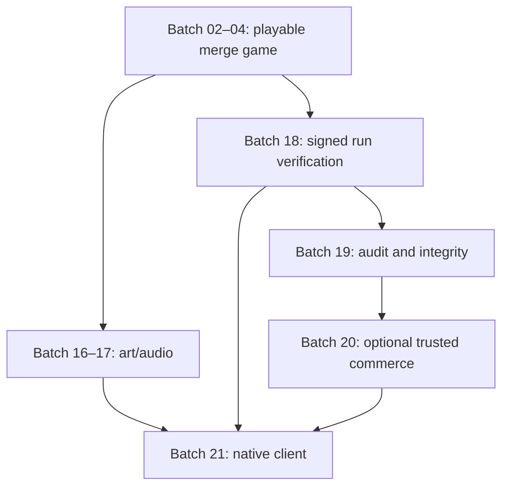

# Cross-batch Authority & Release Dependency Map — Batches 16–21

**Not a deployment record.** This table is the agreement on what each new domain may and may not own.

| Batch | Owner | Owns | Gate |
|---|---|---|---|
| 16 | Visual / Art Pipeline | Visual content, export configurations, asset provenance and art presentation; never gameplay physics or ownership. | `ART_PIPELINE_ENABLED` OFF |
| 17 | Audio / Game Feel | Sound rendering, audio mixer state, cue selection, optional local haptics; no session scoring or rewards. | `AUDIO_PRESENTATION_ENABLED` OFF |
| 18 | Backend / Data / Admin Platform | Accounts, server-verified state, database writes, domain API routes, content publishing, admin controls and durable event delivery. | `TRUSTED_BACKEND_ENABLED` OFF |
| 19 | Application Security / Game Integrity | Cross-service threat models, verification controls, misuse prevention, authorization testing, incident response and audit policy. | `CERTIFIED_SESSION_VERIFICATION_ENABLED` OFF |
| 20 | Product Analytics / Economy / Commerce | Optional monetization policy, financial reporting, privacy-approved analytics, product experiments, retention measurement and operational rollouts. | `COMMERCE_ENABLED` OFF |
| 21 | Platform / Mobile / SRE | iOS/Android packaging, device-specific behavior, CI/CD, store submission, performance optimization and version compatibility. | `NATIVE_APP_RELEASE_ENABLED` OFF |

## Dependency graph

## Non-negotiable ownership

- **Batch 02:** 60Hz fixed-step Rapier, physics body identity and merge arbitration.
- **Batch 03:** 8 canonical tiers; tier 8 terminal; new result auto-serves oldest eligible order.
- **Batch 04:** mission outcomes and score, not the wallet.
- **Batch 05:** campaign graph and published node prerequisites.
- **Batch 06:** authoritative soft-coin ledger and shop pricing.
- **Batch 07:** authenticated XP, skill-point grants and effect caps.
- **Batch 08:** achievements, claim entitlements and inventory provenance.
- **Batch 09:** guest/relationship projections; shop reputation settled by economy policy.
- **Batch 10–12:** conditions/story/events only under published, pinned rules and explicit reward handoffs.
- **Batch 13:** certified leaderboards, normalized competition, immutable seasons.
- **Batch 14:** friends/crews/block/report, with no direct rank/grant authority.
- **Batch 15:** semantic React UI/accessible HUD and Phaser visual bridge.
- **Batch 16–17:** visual/sensory assets only; no game-result mutation.
- **Batch 18–19:** trusted state services and independent security verification.
- **Batch 20:** optional commerce, privacy-reviewed analytics and experimentation; store receipts never equal game score.
- **Batch 21:** packaging, device integration, performance and store submission, with no bypass of game/backend proof.

## Rollout note

Do not run every subsystem before alpha. The browser game is the first value delivery. Trusted money and XP start only after authenticated verification. Ranked and social add further proof/privacy gates. Native requires independent app-store and performance validation.
